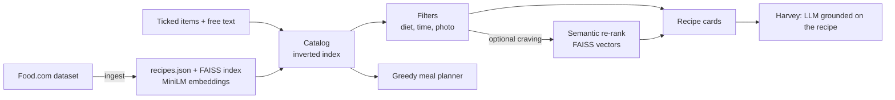

# Anti-waste Recipe Assistant

**Cook what you already have, and buy as little as possible.**

Tick the food you have at home: the app finds recipes you can actually make, tells you which
single purchase would unlock the most new recipes, plans several days of meals that share the
same groceries, and lets you ask a virtual chef about any recipe. Available in English, French,
Spanish and Japanese.

[](../../actions/workflows/tests.yml)

**Live demo:** _coming soon_ · *Version française : [docs/README.fr.md](docs/README.fr.md)*

<!-- Screenshot or GIF: add docs/screenshots/demo.gif, then uncomment the next line. -->
<!--  -->

## Why it is different

Most recipe search tools look for recipes that *resemble* your ingredients. That is not the
same as recipes you can *cook*: semantic search happily returns dishes that need five more
items. This app treats the question as a feasibility problem first.

| Feature | How it works |
|---|---|
| **Feasibility search** | An in-memory inverted index (ingredient word → recipes) scores every candidate by *ingredients you have − ingredients to buy*. Common basics (salt, oil, butter...) can be assumed. |
| **Best purchase** | Counts the recipes that are exactly one item away and ranks those items: "buy bell peppers: 23 more recipes become possible". The purchase can be simulated in one click. |
| **Grocery-aware meal planner** | A greedy optimiser picks one recipe per day, rewarding ingredients from your fridge not used yet and penalising new purchases (an item already on the list is free). It reports items to buy against a naive one-by-one choice. |
| **Harvey, the virtual chef** | An LLM grounded on the recipe on screen answers "no oven?", "for 2 people?", "no cream?" in the user's language. |
| **Fridge photo** | A vision model lists the food in a photo; items are matched to the checklist, the rest goes to a free-text field. |
| **4 languages** | 142 checklist items are translated locally (no API call); recipe titles and pages are translated by the LLM in batches, with an English fallback. |
| **Filters** | Diet (vegetarian, vegan, gluten-free, dairy-free, pork-free, nut-free), total time, light meals, number of items to buy. |

## How it works



Design choices worth noting:

- **Exact matching before embeddings.** Feasibility needs exact ingredient overlap, so the
  core search is an inverted index, not nearest-neighbour search. Embeddings are only used to
  re-order the feasible shortlist when the user types a craving ("dessert", "spicy").
- **Optional heavy dependencies.** Without `sentence-transformers` (and torch), the app still
  runs and simply hides the craving field. Without a Groq key, titles stay in English with a
  notice instead of crashing.
- **Cost control.** Checklist items never call the LLM; batch translation and Streamlit caching
  keep calls low, and a per-session cap (`MAX_LLM_CALLS_PER_SESSION`, default 60) protects the
  API key on a public demo.
- **Measured, not guessed.** `src/evaluate.py` replays 30 realistic fridge contents and reports
  ready-to-cook recipes, items to buy, ingredient coverage and latency (see below).

| Layer | Choice |
|---|---|
| Data | Food.com Recipes and Reviews (Kaggle) |
| Embeddings | `all-MiniLM-L6-v2` (sentence-transformers) + FAISS `IndexFlatL2` |
| LLM | `openai/gpt-oss-120b` on Groq (`GROQ_MODEL`) |
| Vision | `qwen/qwen3.8-27b` on Groq (`GROQ_VISION_MODEL`) |
| UI | Streamlit, custom CSS, hand-drawn SVG illustrations |
| Tests | pytest (~230 tests), GitHub Actions |

## Evaluation

```bash
python -m src.evaluate --write
```

Measured on 29,873 Food.com recipes (32% with a photo) with 30 realistic fridge contents:

| Variant | Queries with ≥ 1 recipe needing no shopping | No-shopping recipes in top 12 | Items to buy (avg) | Ingredient coverage | p95 latency |
|---|---|---|---|---|---|
| Basics assumed, recipes with a photo (app default) | 21/30 | 3.3 | 1.5 | 73% | 0.21 s |
| Basics assumed, all recipes | 24/30 | 5.8 | 0.9 | 74% | 0.23 s |
| No basics, recipes with a photo | 13/30 | 1.0 | 2.3 | 71% | 0.22 s |

Full report: [docs/evaluation.md](docs/evaluation.md).

## Run it locally

```bash
conda create -n recettes python=3.11 -y && conda activate recettes
pip install -r requirements.txt     # if faiss-cpu fails: conda install -c conda-forge faiss-cpu
cp .env.example .env                # add your Groq API key

python -m src.ingest --input data/recipes.csv --format foodcom --sample 30000
python -m src.check_images          # drop dead image links
python -m streamlit run app.py
python -m pytest
```

## Deploy

The full `data/` folder is not versioned. For an online demo, build a compact dataset from it
and commit it:

```bash
python -m src.build_demo --size 12000   # writes demo/recipes.faiss and demo/recipes.json.gz
```

On Streamlit Community Cloud: entry point `app.py`, Python 3.11, and the secrets
`GROQ_API_KEY`, `GROQ_MODEL`, `GROQ_VISION_MODEL`. If installing torch is too slow or too large,
remove `sentence-transformers` from `requirements.txt`: the app keeps working without the
craving re-rank.

## Limitations

- Recipes are in English; translations of titles and steps come from the LLM and are not
  evaluated. Spanish and Japanese interface texts still need a native-speaker review.
- Ingredient matching compares words: "butter" can be confused with "peanut butter", so the
  "to buy" count is approximate.
- Diets are detected from keywords: an indication, not an allergen guarantee.
- Calories come from the dataset (most likely per serving, not verified).
- Recipes without a photo are hidden; a drawn illustration replaces a photo whose link died.
- The per-session LLM cap is a soft limit: reloading the page resets it.

## License

MIT
